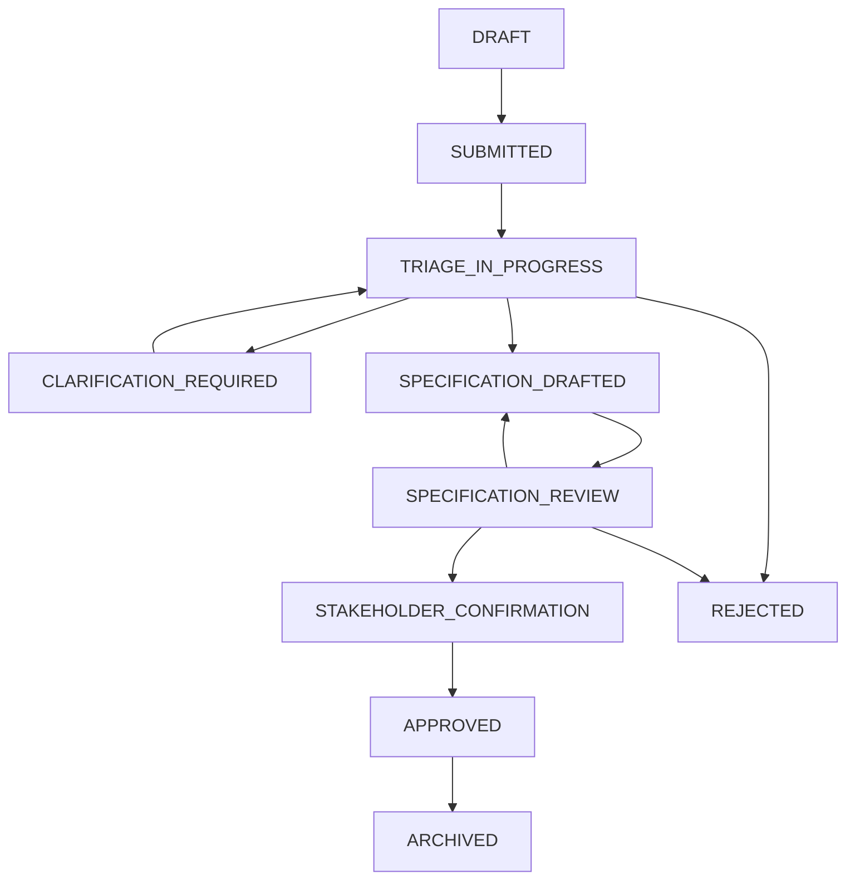
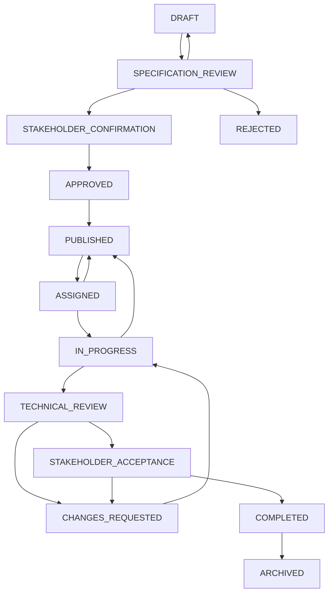

# CivicSpec — Product Requirements Document

**Version:** 1.0.7  
**Date:** November 24, 2026  
**Status:** Consolidated working draft — pending stakeholder approval and validation  
**Author role:** John — BMad Product Manager (simulated)  
**Source:** Project Brief v0.2.1 and PRD v1.0.0–1.0.6 stakeholder amendments, cross-specialist review, approved UX/UI specification v1.0.1 and Section 21.1 GitHub Free entitlement feasibility resolution  
**Project:** Greenfield full-stack application  
**Target:** Full Release 2 pilot-ready MVP; showcase to Next Chapter after readiness, not a separate demo product

## 1. Product overview

CivicSpec is an AI-assisted, conversational requirements engineering and micro-project platform that translates the technical needs of organizations, businesses and individuals into bounded, GitHub-ready engineering specifications, giving justice-impacted, underserved and non-traditional developers verifiable real-world engineering experience.

CivicSpec primarily caters to nonprofits, small businesses, individuals and underserved communities in its long-term vision. Release 2 is restricted to verified 501(c)(3) nonprofits, eligible community groups and individuals acting in a noncommercial capacity. Commercial businesses and projects benefiting commercial operations are deferred to Release 3/4, contingent on legal and operational approval. Submission eligibility does not guarantee approval.

The intended organizational model is nonprofit/social enterprise. Participation is volunteer-first. Financial support directed to builders or the organization operating CivicSpec is entirely optional and independent of engineering services.

Adaptive stakeholder interviews or structured guided intake with optional conversational assistance, direct full-context injection for the pilot (vector-based RAG deferred to Release 3), persistent original cross-mode discovery histories, requirements provenance and blind project discovery bridge the gap between nontechnical problem owners and developers.

### 1.1 Vision and mission

Create an accessible ecosystem where community technical needs become meaningful engineering opportunities and demonstrated capability becomes a credible pathway to professional advancement. Reduce barriers to experience, expand access to technical resources, promote responsible human–AI collaboration and preserve independently inspectable contribution evidence.

### 1.2 Product hypothesis

If AI-assisted dual-mode discovery transforms ambiguous technical needs into human-validated, appropriately scoped specifications with traceable source context, developers can complete meaningful work with less ambiguity, lower operational friction and more credible evidence of competency. The pilot must test this hypothesis.

### 1.3 Stakeholder decision register

| Decision | Direction |
|---|---|
| Organizational model | Nonprofit/social enterprise; legal structure not yet selected |
| Problem-owner eligibility | Pilot: 501(c)(3) nonprofits, eligible community groups and noncommercial individuals; universal eligibility is a post-pilot objective |
| Primary audience | Nonprofits, small businesses, individuals and underserved communities |
| Developer participation | Inclusive; confidential priority routing for justice-impacted builders |
| Financial model | Volunteer-first; entirely optional donations to builders or CivicSpec |
| Project size | Variable according to complexity; bounded deliverables |
| Review | Hybrid human review |
| Repository governance | CivicSpec-owned GitHub organization by default; optional transfer or fork to problem owner |
| GitHub plan & security tier | GitHub Free for Organizations in Release 2 (`FREE_FORK_CI` governance: private repos enforce non-self-merge via Read-only upstream permissions + private fork PRs, and enforce secret scanning via mandatory template Gitleaks CI verified against exact head SHA; public sandbox repo uses native rulesets/secret scanning); abstract behind a governance toggle for clean upgrade to native paid or GitHub for Nonprofits rulesets |
| AI | Conversational requirements engineering with direct full-context injection in Release 2; vector RAG in Release 3; optional coding assistance |
| Source context | Persistent original chat messages and verbatim wizard responses, shared source IDs and authorized developer access |
| Discovery | Submitter identity concealed until confirmed assignment |
| Release objective | Pilot-ready platform serving eligible noncommercial problem owners |
| Builder readiness | Automated sandbox calibration or verified partner cohort graduation; partner graduates enter confidential priority queue |
| Repository provisioning | Mandatory standardized secure templates, Gitleaks CI and deployment runbooks |
| Release approach | Develop directly toward full Release 2 MVP; internal proof-of-concept and alpha are engineering milestones only; showcase to Next Chapter after MVP readiness |
| Template coverage | Multiple approved language/framework templates, each subject to identical security and readiness gates |
| Repository visibility | Private development; public release only after explicit approval (public sandbox repository permitted for synthetic calibration) |
| Queue precedence | Justice-impacted priority first, verified partner priority second, general access third |
| Verification | Minimal consent-controlled shareable verification page required for pilot |
| Lifecycle | Separate submission and micro-project state machines |
| Support boundary | Responsibility ends at COMPLETED by default; optional pre-agreed 14-day in-scope defect window |
| Intake experience | Chat with live profile or traditional guided wizard with optional conversational assistance; seamless switching within one submission |
| Visual experience | Professional civic-tech green/teal; accessible light and dark themes at launch, system preference option |
| Workspace | Shared role-aware CivicSpec workspace integrated with GitHub |
| Verification sharing | Unlisted, revocable, consent-controlled links |
| Brand tagline | Real needs. Real code. Real experience. |

## 2. Goals and non-goals

- **G1:** Accessible technical intake for nontechnical problem owners.
- **G2:** Engineering-ready specifications with explicit scope, deliverables, constraints and testable acceptance criteria.
- **G3:** Equitable opportunity access, including confidential justice-impacted priority routing and blind discovery.
- **G4:** Authentic GitHub workflows: issues, branches, commits, pull requests, tests and review.
- **G5:** Verifiable professional experience supported by durable contribution evidence.
- **G6:** Useful, maintainable technical solutions for genuine stakeholder needs.
- **G7:** Operational sustainability independent of financial transactions.

Non-goals: paid freelance marketplace, employment placement agency, professional certification authority, payment processor, autonomous software development agent, general-purpose project management application, public registry of justice-impacted people, commercial outsourcing service or enterprise-scale software delivery platform.

## 3. Product principles

1. Financial independence: no payment, donation or financial information required for any engineering workflow.
2. Human accountability: humans approve specifications and implementations; developers remain responsible for AI-assisted code.
3. Inclusive participation: no universal credential, justice involvement or partner affiliation requirement.
4. Mission-driven priority: confidential routing for eligible justice-impacted builders.
5. Bounded engineering: explicit scope, deliverables, acceptance criteria and completion conditions.
6. Evidence over credentials: documented contributions, not unsupported competency claims.
7. Privacy by design: minimize and protect sensitive information.
8. Source-level traceability: preserve stakeholder wording from both intake modes separately from AI interpretations.
9. Blind discovery: evaluate work rather than submitter identity or prestige.
10. Mission-focused, not mission-exclusive: evaluate project merit and community impact rather than organizational size or prestige, within release eligibility rules.
11. Interaction choice: neither intake mode nor visual theme affects eligibility, priority, approval or financial obligations.

## 4. Personas and roles

| Role | Objectives and capabilities |
|---|---|
| Problem owner | Eligible pilot individual, 501(c)(3) nonprofit or community group; submit needs through adaptive interviews or a guided wizard, review scope, monitor progress, accept deliverables, coordinate handoff and optionally provide support. |
| Developer/builder | Discover anonymous opportunities, associate GitHub identity, claim or apply, implement, respond to feedback, inspect original stakeholder context after assignment, build contribution history and optionally offer supporter links. |
| Priority-eligible developer | Standard developer with confidential eligibility attribute; may receive early access under approved routing policies. Not a public role. |
| Technical reviewer | Mentor, experienced developer, qualified peer or maintainer; assess scope, feasibility, anonymization, implementation quality and acceptance evidence. Final authority depends on qualifications and risk. |
| Administrator | Moderate, manage roles and confidential eligibility, configure routing, assign reviewers, recover workflows, coordinate handoff and audit verification. |
| Workforce development partner | May support onboarding, mentoring and eligibility confirmation through manual pilot processes; dedicated dashboard deferred. |

## 5. User journeys

**Problem owner:** Register → acknowledge discovery recording and sharing notice → choose/resume chat or guided wizard with live profile → switch modes if desired → clarify missing information → inspect plain-language profile/specification → confirm scope, deliverables and terms → human review and anonymous publication → monitor implementation → evaluate deliverable → accept or request in-scope corrections → handoff → optional support.

**Developer:** Register → profile and verified GitHub identity → sandbox calibration or verified partner graduate bypass → confidential priority eligibility as applicable → browse anonymous projects → evaluate scope, skills and effort → claim or apply → confirmed assignment → authorized submitter identity, original discovery records, project profile and repository context unlocked → implement with optional AI coding assistance → pull request and review → stakeholder acceptance → verified contribution record → optional sharing. Withdrawal remains voluntary, including after disclosure.

**Reviewer:** Authenticate → assigned queue → evaluate specification, suitability and anonymous preview → edit/approve/reject/request clarification → review implementation against approved version → document rationale and technical acceptance.

## 6. Functional requirements

P0 = required for pilot; P1 = enhancement if capacity permits; P2 = post-pilot. Conditional P0 requirements apply when their optional feature is enabled. IDs are retained from the original PRD and amendments; wording is consolidated to remove conflicts.

### 6.1 Identity and access

| ID | Priority | Requirement |
|---|---|---|
| FR-001 | P0 | Allow registration, authentication and session termination. |
| FR-002 | P0 | Enforce problem-owner, developer, reviewer and administrator permissions. |
| FR-003 | P0 | Support multiple authorized roles per account. |
| FR-004 | P0 | Maintain developer professional profiles, skills, experience and interests. |
| FR-005 | P0 | Verify associated GitHub identity before implementation assignment. |
| FR-006 | P0 | Allow specifically authorized administrators to record confidential priority eligibility. |
| FR-007 | P0 | Provide developer professional profile visibility controls. |
| FR-008 | P0 | Support consent-based, administrator-verified partner cohort graduate referrals and sandbox bypass; no partner API required. |

### 6.2 Problem intake

| ID | Priority | Requirement |
|---|---|---|
| FR-009 | P0 | Offer equally accessible chat with a live Living Project Profile and a traditional guided wizard with optional conversational assistance; either mode can complete intake without requiring the other. |
| FR-010 | P0 | Collect problem, desired outcome, current tools/processes, users, constraints, resources and potential data sensitivity. |
| FR-011 | P0 | Save and resume incomplete submissions, original discovery records, current profile, wizard progress and preferred mode across authenticated sessions and devices. |
| FR-012 | P0 | Warn against credentials, unnecessary personal information and confidential records. |
| FR-013 | P0 | Show submission status to its owner. |
| FR-014 | P1 | Accept approved documents, screenshots or references subject to security/privacy controls. |

### 6.3 AI triage

| ID | Priority | Requirement |
|---|---|---|
| FR-015 | P0 | Interpret problem, desired outcome and context. |
| FR-016 | P0 | Recommend technical category. |
| FR-017 | P0 | Detect missing, conflicting or insufficient requirements. |
| FR-018 | P0 | Generate accessible, context-specific follow-up questions as chat messages or structured wizard fields; allow unknown responses, optional help and human escalation. |
| FR-019 | P0 | Incorporate stakeholder responses into iterative analysis. |
| FR-020 | P0 | Recommend feasibility, clarification, decomposition or additional review. |
| FR-021 | P0 | Estimate complexity using dependencies, integrations, effort and testing burden. |
| FR-022 | P0 | Flag unsafe, sensitive, excessive or unsuitable work. |
| FR-023 | P0 | Decompose larger needs into independently bounded projects. |
| FR-024 | P0 | Validate AI output against a structured schema before review. |
| FR-025 | P0 | Escalate unreliable or unsafe interpretations to humans. |
| FR-026 | P0 | Preserve submissions on AI failure; allow controlled retry or manual review; never auto-approve failures. |
| FR-027 | P0 | Record model, prompt version, generation status and revision metadata without unnecessary sensitive prompt retention. |

### 6.4 Specification and approval

| ID | Priority | Requirement |
|---|---|---|
| FR-028 | P0 | Generate structured specification containing all fields in section 7. |
| FR-029 | P0 | Provide plain-language stakeholder summary. |
| FR-030 | P0 | Allow authorized reviewers to edit generated specifications. |
| FR-031 | P0 | Preserve approved revisions and identify active version. |
| FR-032 | P0 | Require owner confirmation of scope, deliverables and expectations. |
| FR-033 | P0 | Require authorized technical approval. |
| FR-034 | P0 | Prevent publication until required technical, stakeholder, anonymization and governance approvals are recorded. |
| FR-035 | P0 | Require renewed approval and participant acknowledgment for material scope changes. |

### 6.5 Discovery and routing

| ID | Priority | Requirement |
|---|---|---|
| FR-036 | P0 | Provide browsable anonymous catalog of approved opportunities. |
| FR-037 | P0 | Filter by category, complexity, skills and availability. |
| FR-038 | P0 | Show non-identifying requirements, deliverables, effort, dependencies and participation terms before assignment. |
| FR-039 | P0 | Allow eligible developers to discover general-release opportunities. |
| FR-040 | P0 | Enforce confidential ordered routing: justice-impacted priority first, verified partner graduate priority second, general access third. Readiness is a separate prerequisite for claiming; dual-eligible builders use the highest applicable tier. No public tier disclosure. |
| FR-041 | P0 | Apply sequential mission-priority, partner-priority and general-access windows with server-controlled timestamps and audited policy; exact durations remain to be approved. Restricted programs require explicit approved policy and must preserve precedence among their eligible participants. |
| FR-042 | P0 | Do not disclose priority eligibility in public profiles or assignments. |
| FR-043 | P0 | Allow live claims or assignment applications only after FR-139 readiness gate passes, subject to routing and project policy. |
| FR-044 | P0 | Prevent conflicting active assignments from concurrent claims. |
| FR-045 | P0 | Allow voluntary withdrawal without loss of unrelated participation access. |
| FR-046 | P0 | Allow documented administrative reassignment of inactive or abandoned projects. |
| FR-047 | P1 | Recommend opportunities based on explicitly provided skills and interests. |

### 6.6 GitHub integration

| ID | Priority | Requirement |
|---|---|---|
| FR-048 | P0 | Integrate with CivicSpec GitHub organization using appropriately scoped credentials. |
| FR-049 | P0 | Associate published implementation projects with approved repositories. |
| FR-050 | P0 | Convert approved specifications into GitHub-ready issues, without leaking restricted context. |
| FR-051 | P0 | Maintain project-to-issue association. |
| FR-052 | P0 | Associate assignments with verified GitHub identities. |
| FR-053 | P0 | Identify or allow reviewers to associate relevant pull requests. |
| FR-054 | P0 | Synchronize relevant issue, pull request and review events. |
| FR-055 | P0 | Authenticate incoming webhook events. |
| FR-056 | P0 | Recover failed synchronization without duplicate issues or inconsistent verification. |
| FR-057 | P0 | Enforce approved repository access, review and branch/merge protection policies via configured governance mode: Read-only upstream permissions with private fork PRs and SHA-gated CI checks in Release 2 (`FREE_FORK_CI`), with clean configuration toggle to native GitHub rulesets (`PAID_NATIVE_RULESETS`) upon paid or nonprofit plan upgrade. |
| FR-058 | P0 | Record approved transfers, forks and other handoffs; automated transfer not required. |
| FR-059 | P0 | Automatically provision private project repositories from a versioned catalog of multiple approved language/framework templates; configure and verify mandatory Gitleaks secret-scanning CI workflow, trusted required CI checks, Read-only builder fork permissions (enforcing BR-007 on GitHub Free) and README runbook; supply one-click deployment configuration where applicable. Support clean upgrade toggle to native GitHub secret scanning and branch rulesets. Block publication/assignment on failed controls. Every supported template must pass the same security and provisioning tests. |

### 6.7 Lifecycle management

| ID | Priority | Requirement |
|---|---|---|
| FR-060 | P0 | Maintain separate authoritative submission and micro-project state machines with one-to-many linkage; each child project has independent approval, assignment, acceptance and completion. |
| FR-061 | P0 | Restrict transitions to authorized actors or validated events. |
| FR-062 | P0 | Display significant events and state changes to authorized participants. |
| FR-063 | P0 | Provide approved clarification/communication mechanism; GitHub and controlled communication may suffice. |
| FR-064 | P1 | Notify participants of assignments, actions, reviews and completion without leaking identities. |
| FR-065 | P0 | Permit authorized cancellation while preserving appropriate history. |

### 6.8 Technical review and acceptance

| ID | Priority | Requirement |
|---|---|---|
| FR-066 | P0 | Assign authorized specification and implementation reviewers. |
| FR-067 | P0 | Review against approved specification and engineering standards. |
| FR-068 | P0 | Record revision requests and rationale. |
| FR-069 | P0 | Record independent technical acceptance against exact approved specification version and immutable accepted code revision, with relevant trusted check results (including Gitleaks secret check and template CI); invalidate affected approval on revision changes (FR-142). |
| FR-070 | P0 | Prevent developers granting final approval to their own work. |
| FR-071 | P0 | Record stakeholder acceptance of the delivered revision against the approved specification; material changes require renewed acceptance. |
| FR-072 | P0 | Escalate disputes; treat out-of-scope requests as separate requirements. |
| FR-073 | P0 | Require technical and stakeholder acceptance before successful completion; distinguish administrative closure. |

### 6.9 Contribution verification

| ID | Priority | Requirement |
|---|---|---|
| FR-074 | P0 | Generate contribution records after successful completion. |
| FR-075 | P0 | Associate project ID/title, approved specification version, developer identity/role, issue, pull request, relevant commits, review outcome, test/criteria results, stakeholder acceptance and completion date. |
| FR-076 | P0 | Preserve authorized evidence independently of external GitHub link availability; no unauthorized code retention. |
| FR-077 | P0 | Provide developer contribution dashboard. |
| FR-078 | P0 | Provide a minimal externally shareable read-only verification page via unlisted, revocable links with developer opt-in, preview of approved stakeholder-safe fields, accurate milestone and revocation status, and no restricted repository content, identity or eligibility leakage. Prevent public indexing/directory listing; enforce revocation server-side and explain links can be forwarded and prior copies cannot be recalled. Private evidence remains protected. |
| FR-079 | P0 | Correct or revoke inaccurate records with audit history. |
| FR-080 | P0 | Exclude confidential eligibility, unauthorized stakeholder data and restricted repository contents. |

### 6.10 Optional financial support

| ID | Priority | Requirement |
|---|---|---|
| FR-081 | P1 | Allow optional approved external builder supporter links. |
| FR-082 | P1 | Allow optional external organizational donation link. |
| FR-083 | P0 | Never require donations, donation acceptance or financial information. |
| FR-084 | P0 | Donations must not affect eligibility, intake, approval, routing, assignment, review, acceptance, verification or handoff. |
| FR-085 | P0 | Clearly label any support interface as voluntary and not required in exchange for engineering services. |
| FR-086 | Conditional P0 | Validate supporter link destinations/schemes and provide reporting mechanism if enabled. |
| FR-087 | P0 | No internal processing, holding, distribution or guarantee of donations; no payment records required for engineering. |

### 6.11 Administration

| ID | Priority | Requirement |
|---|---|---|
| FR-088 | P0 | Provide administrative dashboard for submissions, projects, review and moderation. |
| FR-089 | P0 | Approve, reject, escalate or request submission changes. |
| FR-090 | P0 | Restrict accounts violating participation policies. |
| FR-091 | P0 | Audit consequential administrative, authorization, approval, routing and verification actions. |
| FR-092 | P0 | Configure supported eligibility and routing policies. |
| FR-093 | P0 | Allow reporting of unsafe work, exploitation and misconduct. |
| FR-094 | P0 | Provide basic pilot operational and outcome analytics. |
| FR-095 | P2 | Provide privacy-preserving institutional reporting. |

### 6.12 Conversational intake, RAG and provenance (v1.0.1)

| ID | Priority | Requirement |
|---|---|---|
| FR-096 | P0 | Provide adaptive conversational AI intake and a structured guided wizard with optional conversational assistance, sharing one discovery engine, profile, submission ID and approval workflow. Users may complete the wizard without chatting. |
| FR-097 | P0 | Adapt follow-ups to authorized prior answers in either mode, gaps, conflicts and policies; avoid needless repetition and distinguish unresolved required information from optional questions. |
| FR-098 | P0 | Persist original stakeholder chat messages, assistant questions and verbatim saved wizard answers in one chronological discovery record with stable source IDs, authorship, timestamps, input mode, visibility, question text/version or reference, and revision metadata. Preserve corrections as explicit superseding records under retention policy; never silently overwrite originals with summaries or fabricate chat quotations from form answers. |
| FR-099 | P0 | Resume incomplete discovery in either mode from authoritative saved state, including answered questions, unresolved items, profile revision, wizard progress and preferred mode; no restart or duplicate submission. |
| FR-100 | P0 | Incrementally maintain one structured Living Project Profile from both intake modes, approved documents and reviewed requirements; clearly distinguish derived values from original source records. |
| FR-101 | P0 | Distinguish confirmed, inferred, proposed, disputed and unresolved information. |
| FR-102 | P0 | Link requirements to supporting original chat messages, verbatim wizard answers with question context, approved documents or authorized human decisions via stable source IDs; flag insufficient evidence. |
| FR-103 | P0 | Load the complete authorized bounded cross-mode discovery history and structured profile directly into model context for Release 2, isolated by project and subject to Section 7.4 limits. |
| FR-104 | P2 (Release 3) | Maintain derived vector embeddings and searchable knowledge indexes separate from authoritative records. |
| FR-105 | P0 | Give assigned developers access to relevant authorized original discovery records from both modes, with question context, authorship, timestamps, source IDs and direct source navigation, subject to authorized redaction and privacy restrictions. |
| FR-106 | P2 (Release 3) | Provide indexed keyword or semantic conversation search. |
| FR-107 | P0 | Preserve source references in specifications. |
| FR-108 | P1 | Provide optional developer-facing project-grounded AI assistant. |
| FR-109 | Conditional P0 | If assistant enabled, cite source material for project claims where available; acknowledge insufficient evidence. |
| FR-110 | P2 (Release 3) | Ingest approved supporting documents into retrieval indexes. |
| FR-111 | P0 | Before discovery recording, notify owners how original messages and wizard answers are retained and shared; require acknowledgment and enforce project-level visibility. |
| FR-112 | P0 | Support authorized correction, redaction and deletion per policy without silently changing approved requirements. |
| FR-113 | P0 | Version project knowledge and specifications. |
| FR-114 | P1 | Support post-assignment stakeholder clarification; material changes require scope review. |
| FR-115 | P0 | Enforce retrieval authorization before exposing messages, documents, embeddings or derived context; prevent cross-project leakage. |
| FR-116 | P0 | Apply updates, redactions, deletions and visibility changes to authoritative context and any caches immediately; propagate to derived indexes when introduced in Release 3. |
| FR-117 | P0 | Provide approved specification, profile, authorized cross-mode discovery history and references as a project context package; restricted portions unlock only after assignment. |

### 6.13 Blind project discovery (v1.0.2)

| ID | Priority | Requirement |
|---|---|---|
| FR-118 | P0 | Publish opportunities without revealing submitting organization or individual identity to unassigned developers. |
| FR-119 | P0 | Maintain separate non-identifying publication-ready project profile. |
| FR-120 | P0 | Identify and remove direct and indirect identifiers from discoverable content without modifying authoritative conversations. |
| FR-121 | P0 | Require authorized human anonymization review before publication. |
| FR-122 | P0 | Provide sufficient anonymous objectives, requirements, constraints, scope, deliverables, acceptance criteria, effort, skills, dependencies, community impact and participation/maintenance expectations. |
| FR-123 | P0 | Reveal authorized owner identity only after confirmed assignment; interest or application alone is insufficient. |
| FR-124 | P0 | After confirmed assignment, grant authorized identity, Living Project Profile, original chat and wizard source records, approved documents, source references and repository information. |
| FR-125 | P0 | Prevent identity exposure through pre-assignment search, assistants and retrieval. |
| FR-126 | P0 | Restrict identifying repository links and artifacts before assignment; account for external GitHub visibility. |
| FR-127 | P0 | Permit withdrawal after disclosure and revoke restricted access unless otherwise authorized; previously learned information cannot be erased. |
| FR-128 | P0 | Audit assignment and identity-disclosure authorization events. |
| FR-129 | P1 | Flag repeated claim/withdraw patterns for human review without automatic penalties for legitimate withdrawal. |

### 6.14 Universal problem-owner eligibility (v1.0.3)

| ID | Priority | Requirement |
|---|---|---|
| FR-130 | P0 | Enforce pilot intake eligibility: verified 501(c)(3) nonprofits, eligible community groups and noncommercial individuals only. Reject or defer commercial submissions before AI processing or publication. Expand to businesses and other organizations in Release 3/4 only after legal and operational approval. |
| FR-131 | P0 | Record relevant organization classification for administrative/operational/analytical purposes; classification alone does not determine technical suitability. |
| FR-132 | P0 | Assess technical feasibility, scope, complexity, security/privacy risks, educational value, volunteer suitability, reviewer capacity and governance policies. |
| FR-133 | P0 | Apply consistent specification, implementation, review, acceptance and verification standards across organization categories. |
| FR-134 | P0 | Screen for commercial beneficiaries, exploitation, unreasonable volunteer obligations and substitution of paid work; exclude commercial-benefit projects in Release 2, including submissions through an otherwise eligible person or group. Post-pilot commercial safeguards require separate approval. |
| FR-135 | P0 | Apply blind discovery consistently across all problem-owner categories. |
| FR-136 | P0 | Design for users with limited technical knowledge, finances or infrastructure; no technology department required. |
| FR-137 | P0 | Investigate and restrict organizations for documented policy violations or legitimate governance requirements. |
| FR-138 | P1 | Provide aggregate organization-category and community-impact analytics. |

### 6.15 Sandbox calibration gate (v1.0.4)

| ID | Priority | Requirement |
|---|---|---|
| FR-139 | P0 | Before live claims or assignment applications, require non-partner developers to complete one automated Sandbox Ticket PR in an isolated CivicSpec training repository (which may be hosted as a public repository on the GitHub Free organization using synthetic data only, enabling native GitHub branch protection and secret scanning at zero cost). Verify branch creation, passing prescribed basic tests and a clean PR submission associated with the verified GitHub identity. Allow retries without penalty. Administrator-verified graduates referred by approved partners (e.g., Next Chapter, The Last Mile, Per Scholas; illustrative, not confirmed partners) bypass calibration and enter the priority queue. Bypass does not waive identity, project suitability or other authorization checks. Store pass/bypass status and evidence; enforce the gate server-side and audit decisions. |

Sandbox work uses synthetic data and no production credentials; it does not count as verified real-world experience. A clean PR means the expected branch and target, required checks passing, no unresolved merge conflicts or detected secrets, and required submission metadata. Partner graduation and justice-impacted eligibility are separate confidential attributes; partner priority access does not imply justice involvement. Queue ordering is mission priority, then verified partner priority, then general access; partner verification procedure and window durations remain to be defined. A mission-eligible independent builder must pass calibration before claiming. Partner bypass is readiness evidence, not evidence of justice involvement.

### 6.16 Repository provisioning and handoff

FR-059 is a mandatory provisioning gate, not merely a template-copy operation. Apply repository-level settings through authorized automation and verify them after creation. The README must include local setup, test commands, deployment instructions (where applicable), ownership and maintenance contacts. Use neutral repository identifiers and private development repositories for all pilot projects. Public release requires explicit owner and authorized maintainer approval, licensing clearance, and review of source, history, issues, metadata, deployment URLs, secrets and identifying content. Do not make the original private repository public if its history cannot be safely released; an approved sanitized public artifact is acceptable.

Per the approved Section 21.1 GitHub Free organization decision, Release 2 provisions private repositories using `FREE_FORK_CI` governance: organization settings allow private forks, assigned builders receive `Read` access on the upstream CivicSpec repository (physically preventing direct pushes to `main` or self-merges under BR-007 without paid branch protection rules), and every template bundles mandatory Gitleaks secret-scanning and CI test workflows verified by CivicSpec against the exact PR `head_sha`. Abstract these checks behind a governance-mode adapter so native GitHub secret scanning and rulesets (`PAID_NATIVE_RULESETS`) can be enabled via configuration upon a future paid or GitHub for Nonprofits upgrade. If required template workflows, private fork permissions or `Read`-level access grants fail verification, do not silently substitute weaker controls or publish the repository. Deployment configuration must not require developers to hold production credentials.

BR-039 governs every handoff: agree on support boundary before assignment; record completion time, handoff owner and any agreed defect-window expiry. No ongoing developer maintenance obligation is implied.

### 6.17 Cross-specialist security and feasibility requirements (v1.0.5)

| ID | Priority | Requirement |
|---|---|---|
| FR-140 | P0 | Isolate untrusted sandbox and live PR execution in ephemeral, least-privilege environments without production secrets, privileged tokens or internal network access. Never execute untrusted head code in privileged `pull_request_target` jobs. Validate calibration and live PRs using trusted baseline tests, Gitleaks secret-scanning workflows and workflow definitions outside contributor control; bind required results to verified actor, repository, PR and exact head SHA. Reject modified validation criteria, spoofed checks and stale results. |
| FR-141 | P0 | Maintain version-aware requirement provenance, explicit supersession/conflict links and confirmation status. Validate source IDs against authorized project records; a valid ID alone does not prove semantic support. Human review confirms support. Freeze approved specification versions for assignments; changes require renewed approval and acknowledgment. |
| FR-142 | P0 | Bind technical acceptance, trusted test results, stakeholder acceptance and contribution evidence to the approved specification version and exact delivered commit SHA. Record reviewer, check evidence, acceptance timestamps and handoff status. Invalidate affected acceptance when code or specification changes; reconcile merge/build artifacts with the delivered revision before completion. |
| FR-143 | P0 | Distinguish sandbox exercise, independently reviewed engineering contribution, stakeholder-accepted delivery, production deployment and operational adoption. Record deployment/adoption only with separate evidence; never present synthetic or sandbox work as real-world production experience. |
| FR-144 | P0 | Enforce project definition-of-ready before publication: eligible owner and noncommercial purpose verified; feasibility, scope, testable criteria, source references and anonymous preview approved; reviewer capacity reserved; licensing, maintenance, deployment and handoff terms documented; repository controls (including template Gitleaks CI, private fork readiness and Read-only builder access rules) verified. Record checklist evidence and authorized sign-off. |
| FR-145 | P0 | Grant private repository access (`Read` permission for fork-based PR contribution in Release 2 `FREE_FORK_CI` mode) only after confirmed assignment, and `Write`/`Maintain` access only to authorized reviewers/maintainers; verify GitHub identity and effective permissions. Revoke assignment-derived access upon withdrawal, reassignment or end of need; retry/reconcile failed grants or revocations, alert administrators and block affected transitions until safe. Preserve separately authorized access and acknowledge previously copied data cannot be recalled. |

### 6.18 Approved UX synchronization (v1.0.6)

| ID | Priority | Requirement |
|---|---|---|
| FR-146 | P0 | Permit switching between chat and guided wizard at any discovery step within the same submission. Save pending input before switching or require explicit discard confirmation; preserve committed answers, source IDs, profile and revision history, unresolved items and destination progress. Prevent duplicate saves and stale AI responses from overwriting newer answers; associate AI output with its originating revision and reject or route stale output for review. Restore meaningful focus and announce the destination mode accessibly. Mode choice shall not affect eligibility, routing, review or financial obligations. |

## 7. Dual-mode AI discovery, RAG and specification requirements

### 7.1 Processing stages

Validate submission → interpret intent → screen risk → assess completeness → ask adaptive follow-ups → incorporate answers → assess feasibility and complexity → decompose if necessary → generate structured specification and anonymous preview → validate schemas → human review and stakeholder confirmation. These are logical stages, not a mandate for separate model calls or services.

Triage outcomes: ready for specification, clarification required, decomposition required, manual technical review required, potentially unsuitable. Humans retain final moderation authority. The model must distinguish confirmed information from assumptions, flag uncertainty and avoid treating confidence scores as calibrated probabilities.

### 7.2 Living Project Profile (LPP)

The profile is a versioned, structured representation of the submitted project, not a personal profile of the developer. It captures organization context, problem and desired outcome, current environment, end users/accessibility, functional requirements, business rules, constraints, data inputs/outputs/sensitivity, scope, success criteria, maintenance expectations, open questions and source references. Individual entries distinguish confirmed, inferred, proposed, disputed and unresolved information.

The authoritative discovery store retains original chat messages and verbatim wizard answers, including displayed question text/version, source ID, input mode, author, timestamp, visibility and revision lineage. Both modes share one submission and profile. Derived profile fields are labeled as interpretations and never substituted for original wording. Corrections/redactions/deletions are authorized and auditable under retention policy; approved scope never changes silently. Developers may inspect relevant original wording after confirmed assignment, subject to privacy controls. A redacted view must clearly indicate omissions rather than fabricate replacement quotations.

### 7.3 Specification schema

Mandatory fields: title, problem statement, objective, target users, functional requirements, scope inclusions/exclusions, technical constraints, dependencies, required/recommended skills, complexity, estimated effort range, deliverables, acceptance criteria, testing requirements, security/privacy considerations, documentation requirements, definition of done, plain-language summary, source references and governing version. Ownership, licensing, maintenance and participation expectations must be established before publication.

Provenance chain: specification version → requirement → original chat message, wizard answer with question context, document or recorded human decision. A requirement can have multiple sources; a source can support multiple requirements. Unsupported assumptions are marked and confirmed before becoming binding. A source reference is not a substitute for actual evidence.

### 7.4 Pilot context architecture and deferred RAG

- Release 2 uses direct full-context injection: load the entire authorized, bounded cross-mode discovery record in chronological order, with stable source IDs and question context, the current Living Project Profile, approved specification and applicable platform guidance. No vector database, embedding model, semantic index or document ingestion pipeline is required.
- Enforce project and assignment authorization before loading any data. Exclude restricted/redacted content and confidential eligibility. Treat all stakeholder content as untrusted data, not privileged instructions.
- Define a configurable token budget and maximum conversation size after model selection. Reserve output capacity; if the full authorized history cannot fit, stop generation and escalate for human review or scope refinement. Do not silently truncate source history or fabricate missing requirements.
- Persist original discovery records independently of model context; retain requirement-to-source references and full relevant authorized discovery-record access for assigned developers. Corrections, deletions and permissions take effect on subsequent context loads and caches.
- Release 3 introduces FR-104, FR-106 and FR-110: embeddings/vector indexing, indexed conversation search and document ingestion. Derived indexes must be reconstructable and authorization-aware. Developer assistant remains optional and may use direct context until RAG is introduced.

### 7.4.1 Shared intake interaction contract

- Chat presents adaptive questions and the live profile; the wizard presents structured stages covering need, workflow, scope/constraints, success/handoff and review, with optional inline conversational assistance. Both expose the live profile and unresolved questions; on smaller screens it may be an accessible tab or disclosure.
- Wizard stages are adaptable and may include AI-generated follow-ups as ordinary fields. Users may mark unknown, skip nonessential items, save drafts and request human help; unresolved mandatory requirements block approval, not draft saving. No mandatory chat interaction.
- Use one authoritative saved revision and one AI processing pipeline. Treat both modes' inputs as untrusted data. Do not repeat resolved questions without a reason. Handle contradictory answers through explicit clarification and supersession, not implicit replacement.
- Save operations must be idempotent or otherwise duplicate-safe. A failed save must retain pending input and offer retry; a mode switch must not silently discard it. Late AI outputs cannot overwrite newer revisions or reintroduce redacted/deleted information. AI failures preserve answers and permit human escalation.
- Only authorized relevant originals are exposed to assigned developers and reviewers. Anonymized previews, notifications, downloads, API responses and caches must not leak identities or restricted discovery records. Decomposition does not automatically grant access to unrelated sibling-project context.

### 7.5 Complexity and eligibility framework

Assess clarity, affected components, dependencies, integration complexity, sensitivity, uncertainty, testing burden, security exposure, effort and reviewer capacity. Proposed tiers: foundational (limited dependencies), intermediate (bounded integration/functionality), advanced (independently deliverable functionality with stronger oversight). Effort estimates are advisory; no universal size limit is approved. Oversized work is decomposed, clarified, deferred, referred or rejected rather than admitted without boundaries.

### 7.6 Blind discovery and progressive disclosure

Maintain a separate anonymous publication profile and restricted full project profile. Use AI-assisted anonymization, deterministic checks and human review. Check direct and indirect identifiers: names, logos, domains, contact details, screenshots, metadata, distinctive text, repository names, URLs, code and search results. No restricted data may be sent to the browser simply to be hidden visually.

| Resource | Before confirmed assignment | After confirmed assignment |
|---|---|---|
| Objectives, scope, constraints, acceptance criteria, skills, effort | Anonymous approved version | Authorized full version |
| Community impact and operational context | Non-identifying description | Authorized detail |
| Submitter name, branding, website | Restricted | Authorized disclosure |
| Original chat/wizard records and source references | Restricted; sanitized specification only | Relevant authorized originals |
| Supporting documents and contact details | Restricted | Need-based authorized access |
| Identifying GitHub artifacts | Restricted | Authorized repository access |
| Confidential developer priority eligibility | Never public | Never public |

Priority routing and blind discovery operate independently. Application/interest is not confirmed assignment. Anonymity is best-effort against inference from distinctive technical context, not a guarantee. Private repositories or sanitized public artifacts may be necessary; public artifacts cannot reliably be recalled. Organization size/classification should be withheld when unnecessary (proposed extension). Provide enough material context for informed consent and disclose conflicts or safety concerns through an appropriate process. Withdrawals are allowed after disclosure; revoke access promptly and audit relevant authorization changes.

### 7.7 Example (illustrative)

A food pantry says it tracks inventory in Excel and wants to identify low stock. The assistant asks whether Excel must remain, what thresholds apply, whether data is sensitive and whether changes or read-only reporting are required. The owner says, “We'd prefer to keep Excel because our volunteers already know how to use it.” The profile links the requirement to preserve Excel to that original message. CSV import is an AI-proposed approach, not a confirmed requirement until approved. A bounded specification might require CSV validation, threshold indicators, filtering, local processing, tests and documentation, excluding authentication, donor management and spreadsheet replacement. The public preview omits the pantry's identity; the assigned builder receives authorized original context.

## 8. Lifecycle and state model

Separate state machines are required; one submission may produce multiple independently governed micro-projects. The following diagrams describe canonical flows, not exhaustive transition tables.

Each child micro-project has its own specification revision and approval gates. Submission approval permits decomposition and child creation; it does not automatically approve every child or mark any implementation complete.

Publication requires FR-144; assignment must be atomic and grant context only after confirmation. Repository access provisioning has its own pending/failed/verified status; implementation cannot start until verified. Withdrawal/reassignment revokes prior access and preserves history; unsafe revocation failures block reassignment until resolved. CANCELLED and REJECTED are not successful outcomes. Administrative reopening requires authorization and audit. Technical and stakeholder acceptance must bind the same approved specification and delivered revision (FR-142); completion and verification persist consistently. Material scope changes require renewed approval. Routing, synchronization, deployment/adoption evidence, handoff and defect window are separate dimensions. COMPLETED triggers BR-039; defects do not silently reopen work or extend the window. New features require new intake. Parent status must not silently change child states; cancellation of a parent with active children requires explicit review and per-child resolution.

## 9. Business rules

| ID | Rule |
|---|---|
| BR-001 | All developer participation is voluntary. |
| BR-002 | Donations are optional and independent of engineering services. |
| BR-003 | Justice involvement is not required for general participation. |
| BR-004 | Priority eligibility is confidential. |
| BR-005 | Publication requires human technical approval. |
| BR-006 | Stakeholders confirm requirements before publication. |
| BR-007 | No self-approval or self-merge of final implementation (enforced on GitHub Free via Read-only upstream builder access + private fork PRs). |
| BR-008 | Scope changes require review and participant acknowledgment. |
| BR-009 | Repository custody does not determine IP ownership. |
| BR-010 | Successful completion requires documented acceptance evidence. |
| BR-011 | GitHub merge alone is not successful completion. |
| BR-012 | Donations do not affect routing, assignment, review or verification. |
| BR-013 | Developers may withdraw from volunteer projects. |
| BR-014 | Sensitive/high-risk projects excluded from initial pilot. |
| BR-015 | Contribution records are not employment guarantees or formal certifications. |
| BR-016 | Owners agree to eligibility, ownership, licensing and maintenance terms. |
| BR-017 | Allocation must not expose confidential participant characteristics. |
| BR-018 | Distinguish accepted outcomes from incomplete/disputed work. |
| BR-019 | Original communications remain distinct from AI interpretations. |
| BR-020 | AI assumptions require confirmation before becoming binding. |
| BR-021 | Assigned developers receive relevant authorized discovery context. |
| BR-022 | Do not automatically publish private discovery records, including chat logs and wizard answers, to public GitHub. |
| BR-023 | Corrections/clarifications do not silently modify approved scope. |
| BR-024 | Financial support is independent of AI, context and opportunities. |
| BR-025 | Discovery emphasizes technical suitability/community impact, not recognition. |
| BR-026 | Unassigned developers cannot receive restricted owner identity. |
| BR-027 | Blind discovery applies equally to priority/general routing. |
| BR-028 | Original messages remain distinct from anonymized content. |
| BR-029 | Donations do not affect anonymous visibility, ordering or disclosure. |
| BR-030 | Withdrawal after disclosure carries no financial obligation. |
| BR-031 | Authorized reviewers/admins may access identity for legitimate governance. |
| BR-032 | Long-term outreach targets nonprofits, small businesses, individuals and underserved communities; Release 2 admits only eligible 501(c)(3) nonprofits, community groups and noncommercial individuals. |
| BR-033 | Within release-specific eligibility boundaries, size and recognition do not determine approval; project suitability remains mandatory. |
| BR-034 | Evaluate technical, educational, operational, ethical and legal suitability. |
| BR-035 | Consistent volunteer protections and governance across problem owners. |
| BR-036 | No commercial preference based on contributions or reputation. |
| BR-037 | Donations optional regardless of organization type. |
| BR-038 | Developers need not continue merely because an organization benefits. |
| BR-039 | Developer responsibility terminates at COMPLETED by default. If explicitly agreed before assignment, a fixed 14-calendar-day defect window begins at COMPLETED and covers only defects against the original approved acceptance criteria. After expiry, responsibility ends; no continuing maintenance or feature work is owed. Every subsequent feature request enters intake as a new submission. Participation remains voluntary; CivicSpec or the designated maintainer handles unresolved defects and may arrange reassignment. |

## 10. Project eligibility and governance

Potentially suitable categories: accessibility improvements, community or informational websites, UI improvements, public API integrations, non-sensitive workflow automation, documentation/testing, public-data visualization, bounded application features, approved open-source maintenance and simple operational tools.

Exclude or escalate: sensitive health, financial or legal records; critical infrastructure; high-risk cybersecurity; consequential regulated decisions; unauthorized surveillance; fraud/unlawful requests; ongoing production support beyond capacity; work exceeding review capacity; exploitation or systematic replacement of paid roles. Release 2 excludes commercial businesses and projects serving commercial operations, even if submitted indirectly by an individual or community group. Verify 501(c)(3) status or noncommercial purpose through proportionate administrative review. Commercial expansion is deferred to Release 3/4 subject to legal and operational approval. This removes commercial participation from the pilot critical path, but does not establish that all remaining volunteer arrangements are lawful. No legal determination has been made.

Hybrid review may involve mentors, qualified peers, experienced volunteers and CivicSpec staff. Final approval requires appropriate independent authority. Technical acceptance and stakeholder acceptance are distinct. Scope, licensing, ownership and maintenance terms must be clear before implementation. No automatic AI approval, merge, certification or consequential eligibility decisions.

## 11. Nonfunctional requirements

| ID | Requirement |
|---|---|
| NFR-001 | Encrypt externally accessible application traffic. |
| NFR-002 | Enforce protected operations server-side. |
| NFR-003 | Keep credentials and integration secrets out of clients/public repos. |
| NFR-004 | Validate and safely render user content. |
| NFR-005 | Least privilege for administrative and GitHub access. |
| NFR-006 | Verify webhooks and tolerate duplicate delivery. |
| NFR-007 | Rate-limit and protect auth, submission and AI endpoints. |
| NFR-008 | Exclude production secrets and sensitive data from routine logs. |
| NFR-009 | Restrict priority eligibility to specifically authorized actors/processes. |
| NFR-010 | Avoid detailed criminal history unless necessary and lawfully approved. |
| NFR-011 | Explicit public profile and verification visibility controls. |
| NFR-012 | Establish retention/deletion policies before pilot. |
| NFR-013 | Minimize approved stakeholder data sent to AI providers. |
| NFR-014 | Proposed p95 non-AI API latency ≤500 ms under agreed pilot load, excluding external delays. |
| NFR-015 | Proposed primary page usability within ~3 seconds on representative devices/networks. |
| NFR-016 | Visible AI processing feedback; no mandatory blocking screen. |
| NFR-017 | Asynchronous processing for long operations. |
| NFR-018 | AI/GitHub failures do not erase approved data. |
| NFR-019 | Retries avoid duplicate issues, assignments and records. |
| NFR-020 | Backups and tested restoration before pilot. |
| NFR-021 | Understandable external failure/recovery states. |
| NFR-022 | Consistent consequential state transitions. |
| NFR-023 | Proposed WCAG 2.2 AA target for core journeys. |
| NFR-024 | Keyboard-operable core workflows. |
| NFR-025 | Assistive-technology-perceivable errors and status changes. |
| NFR-026 | Minimize stakeholder-facing technical jargon. |
| NFR-027 | Responsive desktop/mobile browser layouts. |
| NFR-028 | Clear logical subsystem boundaries. |
| NFR-029 | Automated tests for critical business rules. |
| NFR-030 | Document external interfaces and recovery behavior. |
| NFR-031 | Controlled database migrations. |
| NFR-032 | Document deployment and operations. |
| NFR-033 | Structured operational logging. |
| NFR-034 | Identify failed AI/GitHub synchronization operations. |
| NFR-035 | Correlation IDs for asynchronous/integration operations. |
| NFR-036 | Minimize sensitive data in monitoring. |
| NFR-037 | Secure storage and authorization for original discovery records across both intake modes. |
| NFR-038 | Project-level retrieval isolation. |
| NFR-039 | Traceable AI outputs where source material exists. |
| NFR-040 | Treat retrieved content as untrusted data, not privileged instructions. |
| NFR-041 | Retention/redaction/deletion apply to originals and derived indexes. |
| NFR-042 | Release 3: reconstruct retrieval indexes from authorized sources; not a Release 2 gate. |
| NFR-043 | Enforce identity restrictions server-side, not just in UI. |
| NFR-044 | Prevent identity leaks via unauthorized APIs, indexes, caches, metadata or AI retrieval. |
| NFR-045 | Propagate assignment/withdrawal authorization changes. |
| NFR-046 | Automated authorization and representative anonymization leakage tests. |
| NFR-047 | Isolate untrusted code execution from production credentials, persistent privileged runners and production data; use ephemeral execution and trusted test definitions. |
| NFR-048 | Separate deployment credentials and workflows from untrusted PR execution; deploy only authorized reviewed revisions via protected environments and least-privilege credentials. |
| NFR-049 | Verify GitHub integration permissions, webhook authenticity and idempotency; reconcile access grants/revocations and active governance-mode security controls (`FREE_FORK_CI` or `PAID_NATIVE_RULESETS`) with authoritative external state. |
| NFR-050 | Validate source references, revision identity and context budget server-side; isolate untrusted stakeholder content from privileged instructions and deny AI autonomous privileged actions. |
| NFR-051 | Provide accessible light and dark themes for all MVP routes, components and states, including public verification pages, targeting WCAG 2.2 AA in both. Offer Light/Dark/System preference, default to system, persist explicit preference locally for visitors and in account settings for signed-in users; use semantic theme tokens and no confidential data in theme storage. Switching themes must preserve draft inputs, focus, route and authentication state. Validate contrast, keyboard navigation, reflow, focus and assistive technology behavior in both themes and intake modes. |

## 12. Logical data requirements

Conceptual entities (not a finalized database schema):

| Entity | Purpose |
|---|---|
| User, Role | Authentication, account status, authorized responsibilities |
| DeveloperProfile | Professional info, skills, interests, visibility |
| PriorityEligibility | Restricted designation and authorization metadata |
| Organization | Owner/partner context and classification |
| ProblemSubmission | Original request, owner and context |
| Clarification, TriageResult | Questions/responses, classification, risk, assumptions |
| Conversation, ConversationMessage / DiscoverySourceRecord | Shared discovery sessions and original chat/wizard records with stable ID, question context/version, author, time, input mode, visibility and revision/supersession; names are conceptual |
| DiscoveryDraftState | Submission-bound mode preference, wizard progress, saved revision and unresolved items; no separate submission per mode |
| UserPreference | Light/Dark/System preference and non-sensitive presentation settings |
| ProjectProfile | Versioned structured knowledge (LPP) |
| Requirement, RequirementSource | Requirement status and many-to-many links to supporting evidence |
| KnowledgeDocument, KnowledgeChunk | Approved source material and derived retrieval index references (Release 3) |
| SandboxCalibration, PartnerReferral | Readiness evidence, verified graduate bypass and confidential routing authorization |
| Specification | Versioned approved engineering requirements |
| RequirementRevision | Supersession, conflict and source links; confirmation and approved version |
| RepositoryTemplate, ProvisioningRecord | Versioned language/framework catalog, active governance mode (`FREE_FORK_CI` / `PAID_NATIVE_RULESETS`), Gitleaks/CI security settings and verification results |
| RepositoryAccessGrant | Assignment/role-bound permissions (`Read` for fork contributors in `FREE_FORK_CI`, `Write`/`Maintain` for reviewers), grant and revocation reconciliation |
| ReadinessChecklist | Publication evidence and authorized sign-off |
| DeliveryRevision, MilestoneEvidence | Accepted SHA, specification version, trusted checks, delivery/deployment/adoption evidence |
| VerificationShare | Consent, approved public fields, revocable sharing status |
| Project, AnonymousProjectProfile | Bounded opportunity, lifecycle and sanitized publication representation |
| RoutingPolicy, ProjectAssignment | Access windows, assignment and participation history |
| RepositoryReference, GitHubIssueReference, PullRequestReference | GitHub associations and synchronization metadata |
| Review, AcceptanceRecord | Reviewer decisions, technical and stakeholder acceptance |
| ContributionRecord | Verified outcome and authorized evidence |
| RepositoryHandoff | Delivery/transfer/fork record, maintenance owner, completion and optional defect-window expiry |
| SupporterLink | Optional external support destination |
| AuditEvent | Consequential actions and disclosure authorization |

No payment, invoice, escrow or transaction ledger entity is required. Preserve evidence before repository handoff, without retaining unauthorized code or private data. Repository visibility and licensing decisions must support blind discovery and authorized portfolio evidence. A CivicSpec GitHub organization is the default active development environment; final ownership, licensing and maintenance are separate decisions.

## 13. Information architecture

| Workspace | Pages / functions |
|---|---|
| Public | Landing, how it works, anonymous catalog/detail, about, guidelines, privacy/terms, optional support |
| Owner | Dashboard, new/resumed chat or guided wizard intake, drafts, clarifications, living profile, specification confirmation, progress, acceptance, history |
| Developer | Profile, anonymous catalog, assignment application/claim, active projects, feedback, completed projects, contribution history, optional supporter settings |
| Assigned project | Overview, approved specification, original chat and wizard source records, approved documents (if enabled), optional project assistant, GitHub context |
| Reviewer | Assigned specification and implementation queues, anonymization preview, source evidence, review history |
| Administrator | Operations, moderation, roles, confidential eligibility, routing, organization controls, projects, review assignment, integration monitoring, verification, audit, pilot analytics |

Shared role-aware application shell and GitHub-integrated project workspace follow approved UX/UI v1.0.1. Provide accessible theme selection in public navigation and authenticated settings; use the approved professional green/teal direction and tagline “Real needs. Real code. Real experience.” Exact tokens, final logo and implementation details remain subject to validation. Verification links are unlisted and revocable, not searchable public profiles.

## 14. Development epics and user stories

Stories retain the original IDs where applicable. New stories extend rather than replace original behavior. Acceptance criteria are condensed into testable outcomes; Section 6 remains the normative functional inventory.

| Story | User need | Acceptance criteria |
|---|---|---|
| US-1.1 | Participant authenticates | Valid registration/login; protected access rejected without authentication; understandable errors. |
| US-1.2 | Admin manages roles | Server authorization, denied unauthorized changes, audit. |
| US-1.3 | Builder maintains profile/GitHub | Save/update profile, verify GitHub identity, no public eligibility. |
| US-2.1 | Owner describes need | Either chat or guided wizard collects necessary context and warnings; no mandatory chat interaction. |
| US-2.2 | Owner saves/resumes | Draft, original cross-mode records and mode progress survive sessions; private access enforced. |
| US-2.3 | Owner clarifies | Questions/responses linked to correct submission and subsequent analysis. |
| US-3.1 | Owner identifies missing requirements | Distinguish assumptions; relevant follow-ups; human escalation. |
| US-3.2 | Reviewer assesses complexity | Structured recommendation, rationale for risk flags, no AI publication. |
| US-3.3 | Reviewer obtains specification | Mandatory schema valid, explicit scope and criteria; malformed outputs blocked. |
| US-3.4 | Reviewer decomposes | Distinct deliverables, dependencies, independent publication approval. |
| US-4.1 | Reviewer edits/approves | Traceable revisions and rationale; unapproved specs blocked. |
| US-4.2 | Owner confirms scope | Plain summary, inclusions/exclusions, version-bound confirmation. |
| US-4.3 | Admin publishes suitable work | Required approvals, governance/anonymization checks and audit. |
| US-5.1 | Builder browses | Anonymous project details and filters; no restricted resources. |
| US-5.2 | Priority builder accesses designated work | Configured window and general release; confidential eligibility. |
| US-5.3 | Builder claims/applies | Server validates eligibility/availability; no conflicting concurrent assignments; persistent record. |
| US-5.4 | Builder withdraws | Allowed without unrelated exclusion; reassignment and access revocation. |
| US-6.1 | Admin publishes GitHub issue | Approved authorized content, stored issue ID, idempotent retries. |
| US-6.2 | Builder associates work | Valid PRs linked to verified identity; unrelated references rejected or reviewed. |
| US-6.3 | Reviewer sees GitHub activity | Valid events synchronized; invalid signatures rejected; duplicate events safe. |
| US-7.1 | Reviewer validates work | Approved criteria, recorded feedback and no self-approval. |
| US-7.2 | Owner accepts delivery | Technical acceptance first; decision recorded; no silent scope changes. |
| US-7.3 | Admin coordinates handoff | Method, ownership and maintenance acknowledged; evidence preserved. |
| US-8.1 | Builder receives verification | Both acceptances and correct evidence/identity. |
| US-8.2 | Builder views history | Completed records and authorized evidence; no confidential eligibility. |
| US-8.3 (P0) | Builder shares evidence | Developer-controlled revocable link, accurate milestone and verification status, approved public fields only; restricted content protected. |
| US-9.1 | Admin moderates | Approve/reject/escalate/cancel with rationale and visible relevant status. |
| US-9.2 | Admin manages priority | Restricted authorization, policy enforcement and audit. |
| US-9.3 | Admin evaluates pilot | Core metrics and failure visibility; privacy-preserving reporting. |
| US-10.1 (P1) | Builder offers supporter link | Optional, validated, removable. |
| US-10.2 (P1) | Supporter contributes to CivicSpec | Voluntary, external, no promised engineering benefit. |
| US-10.3 (P0) | Participant uses service without money | Complete lifecycle without financial data; no routing/verification effect. |
| US-11.1 | Builder inspects original owner context | Confirmed assignment grants relevant original messages with provenance and redaction indicators; unassigned requests denied. |
| US-11.2 | Owner/ reviewer traces requirements | Each requirement links to evidence or explicit unresolved status; approved version stable. |
| US-11.3 | AI retrieves authorized context | Project boundaries enforced; deleted/restricted material excluded; no fabricated confirmation. |
| US-11.4 (P1) | Builder asks project assistant | Source-grounded answers, uncertainty acknowledged, no scope mutation. |
| US-12.1 | Builder chooses work without brand bias | Anonymous profile contains sufficient technical detail; APIs, search and GitHub do not reveal identity before assignment. |
| US-12.2 | Builder receives identity after assignment | Confirmed assignment authorizes disclosure and audit; mere application does not. |
| US-13.1 | Eligible pilot owner submits | Same accessible intake for eligible nonprofits, community groups and noncommercial individuals; commercial submissions blocked/deferred. Universal intake deferred to Release 3/4. |
| US-13.2 | Admin evaluates pilot eligibility | Verify eligible category and noncommercial beneficiary; reject circumvention; defer commercial work. |
| US-5.5 | Builder calibrates or receives verified bypass | Passing sandbox PR unlocks claims; failed or unverified checks do not; verified partner graduate enters priority queue; no public disclosure. |
| US-6.4 | Admin provisions secure repository | Template, mandatory Gitleaks secret-scanning CI, Read-only fork permission rules, trusted CI checks and runbook verified before publication; deploy configuration where applicable; governance adapter supports upgrade to native rulesets. |
| US-7.4 | Builder finishes bounded assignment | Completion ends responsibility or starts pre-agreed 14-day defect window; new features require new intake; maintenance owner recorded. |
| US-5.6 | Builder receives ordered access | Mission tier precedes partner tier, then general; dual eligibility uses highest tier; readiness enforced separately. |
| US-6.5 | Maintainer validates multiple templates | Each approved template provisions privately with verified Gitleaks/CI controls and Read-only fork workflow; failed settings block publication. |
| US-6.6 | Admin manages repository access | Grant Read-only upstream access (or authorized reviewer Write access) only after assignment; revoke and reconcile on withdrawal; failures block unsafe reassignment. |
| US-6.7 | Builder completes trusted calibration | Untrusted code isolated; modified tests or stale/spoofed checks cannot unlock claims. |
| US-11.5 | Reviewer traces revised requirements | Superseded statements not binding; source IDs and semantic support validated; approved versions immutable. |
| US-7.5 | Reviewer accepts exact delivery | Revision-specific checks and approvals; changes invalidate affected acceptance. |
| US-8.4 | Builder shares accurate evidence | Sandbox, accepted delivery, deployment and adoption distinguished; no unsupported claims. |
| US-4.4 | Admin publishes ready project | FR-144 checklist and evidence required; unavailable reviewers block publication. |
| US-3.5 | Owner decomposes a submission | Multiple children independently approved and completed; parent changes do not silently mutate children. |

Additional UX synchronization stories (P0):

| Story | User need | Acceptance criteria |
|---|---|---|
| US-2.4 | Owner switches intake methods | One submission, shared profile, stable source IDs, no lost or duplicated committed input; explicit pending-input handling and accessible focus. |
| US-2.5 | Owner completes guided wizard | Structured follow-ups and optional help; no chat required; manual escalation on AI failure; unresolved mandatory items block approval only. |
| US-2.6 | Builder inspects original evidence | Chat and wizard originals with exact wording, question context and source anchors; restricted records denied before assignment. |
| US-1.4 | Participant selects accessible theme | Light/Dark/System persisted; switching retains draft, focus, route and authentication; both themes pass accessibility checks. |

Epic mapping: E1 Platform Foundation (US-1); E2 Stakeholder Intake (US-2); E3 AI Triage and Specification (US-3); E4 Human Review and Publication (US-4); E5 Discovery and Priority Routing (US-5); E6 GitHub Integration (US-6); E7 Delivery and Technical Acceptance (US-7); E8 Verified Experience (US-8); E9 Administration and Governance (US-9); E10 Optional Support (US-10); E11 Conversational Knowledge and Provenance (US-11); E12 Blind Discovery (US-12); E13 Inclusive Problem-Owner Governance (US-13). E11–E13 are cross-cutting extensions and may be implemented within E2–E9 rather than independently scheduled.

Dependency outline: E1 → E2/E11 → E3 → E4/E12/E13 → E5/E6 → E7 → E8. E9 spans the core workflow. E10 is off the critical path. Deliver security and authorization tests alongside each increment, not after feature development.

## 15. Pilot metrics

**North star (proposed):** Verified Engineering Outcomes — number of real-world projects meeting technical and stakeholder acceptance with documented contribution evidence. Count projects once; track developer contributions separately.

| Area | Metrics |
|---|---|
| Requirements | Submission-to-approved-spec conversion, time to approval, major revision rate, clarification cycles, manual escalation, provenance coverage |
| Developer | First real-world project completions, claim-to-completion rate, contribution records, repeat participation, time to first completion |
| Community | Needs addressed, stakeholder acceptance and satisfaction, continued usability |
| Mission | Suitable opportunity access and wait times across tiers, completion rates, partner participation; privacy-preserving aggregates |
| Operations | Reviewer turnaround, AI/GitHub failures, abandonment, administrative workload, identity leakage incidents |
| AI quality | Completeness, unsupported assumptions, scope adherence, testability, risk detection, reviewer correction effort, source accuracy |

Donation volume is not a primary product metric. Metrics and eligibility reporting must avoid exposing individuals or small cohorts unnecessarily.

## 16. Proposed pilot parameters

Suggested, not approved: 3–5 problem owners (initial outreach focused on 501(c)(3) nonprofits, community groups and noncommercial individuals), 10–20 developers, 2–4 experienced reviewers, 10–20 approved projects, 6–8 weeks. Commercial implementation is excluded from Release 2; legal and operational clearance is required for post-pilot expansion. Proposed benchmarks: at least 70% of published projects successfully complete; at least 80% of completed projects receive positive stakeholder satisfaction responses (define denominator and handle nonresponse); 100% of completed projects have technical/stakeholder acceptance; 100% of published projects pass approval gates; zero confirmed unauthorized public eligibility disclosures. Add leakage and source accuracy tests as release gates, rather than assume anonymization is perfect.

Illustrative capacity scenario: 20 projects × 3 reviewer-hours = 60 hours; 3 reviewers over 8 weeks = 2.5 hours per reviewer per week; 70% completion = 14 verified outcomes. Excludes onboarding, moderation, infrastructure and overhead. Targets require partner recruitment, budget and capacity validation.

## 17. Release strategy and scope

Development proceeds directly toward the full Release 2 pilot MVP. Releases 0 and 1 are internal engineering increments, not a separate minimum viable demonstration or a reduced product target. The intended Next Chapter showcase occurs after MVP readiness; no partnership, endorsement or participation is assumed. A showcase can use clearly labeled synthetic accounts/data and must not expose real restricted records. Feature changes require explicit change control, but there is no demo-specific feature freeze.

| Release | Scope |
|---|---|
| 0 — Proof of concept | Dual-mode intake, persistent original discovery records, structured outputs, human-editable profile/specification and source links. |
| 1 — Workflow alpha | Authentication, approval, anonymous publication, assignment, identity unlock, GitHub issue association and basic review. |
| 2 — Pilot MVP | Full P0 flow for eligible noncommercial owners; direct full-context injection, sandbox gate/partner bypass, secure multi-template provisioning on GitHub Free (`FREE_FORK_CI` with Gitleaks CI + Read-only fork PRs), confidential routing, bounded handoff, privacy/security and legal/operational readiness; private development and approved public release, ordered routing, separate state machines, unlisted revocable shareable verification, FR-140–146 and accessible light/dark themes (NFR-051). |
| 3 — Pilot refinement | Usability/reliability improvements; vector embeddings and RAG indexing (FR-104/106/110), developer assistant, expanded verification features and optional supporter links as capacity permits; commercial expansion and native GitHub rulesets upgrade (`PAID_NATIVE_RULESETS`) if approved. |
| 4 — Institutional expansion | Partner management/reporting, enhanced mentorship and integrations; commercial expansion if not introduced in Release 3 and separately approved. |

Excluded from pilot: commercial submissions/implementation, paid GitHub org subscriptions (native private-repo branch rulesets/secret protection deferred behind governance adapter), vector embeddings and RAG indexing, native mobile apps, integrated financial processing/escrow, paid marketplace, advanced reputation algorithms, comprehensive institutional dashboards, autonomous AI implementation, automated production infrastructure, formal placement services, complex enterprise projects, high-risk regulated systems and automated repository ownership transfer. Manual administrative processes may be used where appropriate. No particular technology stack is approved.

## 18. MVP release acceptance criteria

1. Nontechnical owner of any eligible category can submit and resume a real need through either adaptive chat or guided wizard with optional conversational assistance, without requiring chat.
2. Original chat messages and verbatim wizard answers persist with source IDs, question context, attribution, input mode and timestamps; the LPP distinguishes confirmed and proposed information.
3. AI identifies missing requirements, injects the complete bounded authorized context and generates schema-valid, source-linked specifications; failures recover safely.
4. Authorized humans edit, approve or reject; owner confirms scope and terms; anonymization and governance gates block unsuitable publication.
5. Anonymous opportunities provide sufficient technical detail without disclosing restricted identities through UI, API, retrieval or GitHub artifacts.
6. Confidential priority routing and general access function per approved policy.
7. Eligible builders claim/apply; concurrent claims are safe; only confirmed assignment unlocks authorized identity and original conversation context.
8. Withdrawal revokes restricted access and permits reassignment.
9. Approved projects link to CivicSpec repositories/issues; implementation evidence and GitHub events synchronize reliably.
10. Independent reviewers evaluate work; owners accept delivered solutions; both acceptances are required for successful completion.
11. Verified contribution records persist and remain correctly attributed, including after authorized handoff.
12. Administrators can moderate, audit, correct and recover workflows.
13. Security, privacy, accessibility, data retention and restoration checks pass; legal/operational participation policies are approved.
14. The entire workflow completes without a financial transaction or donation information.
15. Commercial submissions and commercial-benefit projects are blocked/deferred; only eligible pilot owners enter intake.
16. A non-partner cannot claim live work until an automated sandbox PR passes; verified partner graduates bypass into the confidential priority queue.
17. Every project repository is automatically provisioned on the GitHub Free organization with verified Gitleaks secret-scanning CI, Read-only upstream fork permissions (blocking direct pushes to `main` and self-merges), and required checks; missing controls block release.
18. Completion terminates developer responsibility unless an agreed 14-day in-scope defect window applies; new features require new intake.
19. End-to-end AI discovery works without embeddings or a vector database; oversized context escalates without silent truncation.
20. Multiple approved language/framework templates provision successfully with equivalent mandatory Gitleaks/CI controls and Read-only fork workflow; private repositories become public only through approved release review.
21. Mission priority precedes partner priority, then general; dual eligibility, expired windows, unready users and confidential attributes are tested.
22. Shareable verification pages are consent-controlled, externally inspectable, revocable and privacy-safe; sandbox or undeployed work is not mislabeled.
23. Separate submission and project state machines support independent child approvals, assignments and completion.
24. Trusted isolated sandbox checks reject tampering, stale results and spoofed identities; untrusted PR code cannot access privileged secrets.
25. Version-aware provenance and revision-specific acceptance pass positive and negative tests; changed revisions invalidate affected approvals.
26. FR-144 readiness gate blocks incomplete projects; FR-145 access grant/revocation and failure reconciliation are tested.
27. Chat-to-wizard-to-chat and wizard-to-chat-to-wizard switching retain committed answers, stable source IDs, shared profile and progress in one submission; pending inputs are saved or explicitly discarded; no duplicate submissions or repeated resolved questions without cause.
28. Stale AI responses, concurrent edits and failed saves cannot silently overwrite newer answers; original records and correction lineage remain inspectable, and approved scope is unchanged until renewed approval.
29. Light, dark and system preference work across all MVP routes; theme changes preserve drafts, focus, routing and authentication. Both themes and intake modes meet the accessibility target, including keyboard and assistive technology testing.
30. Assigned builders can navigate from a requirement to original authorized chat or wizard evidence; unassigned and unrelated-project users cannot access either type through any interface or API.
31. Shareable verification is unlisted, revocable and consent-controlled; approved-field preview matches the actual external representation; revoked links no longer disclose records.

## 19. Testing strategy

- Unit tests for business rules, priority policies, state transitions and financial independence.
- Integration tests for auth/role/project permissions, database consistency, GitHub signatures, retries, duplicate events and concurrent claims.
- AI evaluation against manually reviewed representative clear, ambiguous, complex and unsuitable submissions; verify schema, source support, clarification quality, prompt-injection resistance and recovery.
- Direct-context isolation tests covering cross-project access, pre-assignment restrictions, cache invalidation, redactions, deleted content and context overflow; index tests deferred to Release 3.
- Sandbox tests: failed/passing checks, verified/unverified referrals, direct API claim bypass attempts, duplicate webhook events, safe retries and synthetic-data isolation.
- Repository tests: template creation, `FREE_FORK_CI` controls verification (confirming Read-only builder cannot push directly to `main` or self-merge, Gitleaks CI blocks synthetic secrets on PRs, and exact `head_sha` validation works), failed provisioning, neutral naming, applicable deploy configuration, and governance-adapter toggle compatibility.
- Handoff tests: completion timestamp, default closure, 14-day expiry, original-criteria defects versus new features and maintainer assignment.
- Pilot eligibility tests: eligible nonprofit/group/individual and direct or indirect commercial beneficiaries.
- Anonymization leakage tests using identifiers in descriptions, URLs, document metadata, screenshots, APIs, search, notifications and external repository artifacts; manual review of publication previews.
- End-to-end tests for conversation resumption, publication, routing, assignment, context unlock, withdrawal, implementation, review, stakeholder acceptance and verification; repeat without any donation data.
- Accessibility, backup restoration, handoff verification and stakeholder user acceptance testing.
- Governance scenarios for commercial exploitation, inappropriate scope expansion and confidential eligibility disclosure.
- Negative tests: untrusted PR modifies workflow/tests, spoofs check identity, uses stale SHA, attempts privileged secret access; reject calibration and deployment.
- Verify each supported template's provisioning, private visibility, Gitleaks/CI controls, trusted CI, runbook and applicable deployment; inspect approved public artifacts for history/metadata leaks.
- Test queue precedence, readiness independence, dual eligibility, boundary timestamps and confidential policy output.
- Test parent/child state independence, superseded requirement sources, invalid source IDs, changed SHA/spec invalidation, and acceptance against exact delivered artifact.
- Test share consent/revocation, restricted fields, false deployment claims, ready checklist failures, repository permission drift and failed access revocation.
- Run complete intake-to-approval scenarios separately in chat-only, wizard-only and mixed-mode flows; verify equivalent governance, exact source wording, question context, source IDs, correction history, resume across devices and authorized source navigation.
- Exercise pending saves, explicit discard, network failures, duplicate retries, stale AI results, concurrent edits, context overflow, redaction/deletion and sibling-project authorization for both modes.
- Test Light/Dark/System persistence, system preference changes, first render, keyboard focus, draft retention, dialogs, errors, charts and public verification in both themes; perform manual assistive technology and responsive reflow checks in addition to automated scans.
- Test unlisted link preview, consent, non-indexing controls, revocation, cache behavior and neutral unavailable states; do not treat unlisted links as confidential.

## 20. Dependencies and constraints

External dependencies: CivicSpec GitHub organization (GitHub Free tier for Release 2) and API access, AI inference provider/model, hosting, persistent data storage, authentication, reviewers, developers and participating problem owners. Operational constraints: limited review capacity, zero-cost GitHub Free org entitlement boundaries on private repositories, unknown budget, volunteer availability, AI costs, API outages, legal/governance requirements and post-delivery maintenance capacity.

Architectural constraints: GitHub default collaboration; CivicSpec authoritative governance/verification and conversation records; human approval; isolated eligibility and project retrieval; separate public/restricted representations; donation independence; abstracted repository governance mode (`FREE_FORK_CI` default, `PAID_NATIVE_RULESETS` upgradeable). No specific LLM, embedding model, vector database, orchestration framework, hosting provider or deployment architecture selected. Logical subsystem boundaries do not require separate deployed services.

## 21. Outstanding decisions and validation

| Decision | Current status |
|---|---|
| Legal organizational structure, tax status, donation and volunteer policies | Unvalidated; pilot-specific volunteer, donation and organizational review still required. Commercial beneficiary review moved to post-pilot expansion, not a Release 2 dependency. |
| Priority eligibility method | Justice-impacted eligibility method remains proposed; verified partner graduate bypass approved, verification procedure to define; mission > partner > general precedence approved |
| Priority window duration | Proposed configurable per project/program; not approved |
| Claim vs application | Proposed hybrid based on complexity; not approved |
| Reviewer qualifications/final authority | To define |
| Inactivity and reassignment thresholds | To define |
| Complexity/risk boundaries | Provisional tiers; pilot limits to validate |
| Repository visibility/provisioning | **Resolved for Release 2:** Private development repositories on GitHub Free org using `FREE_FORK_CI` governance (Read-only upstream permissions + private fork PRs + mandatory template Gitleaks CI verified against `head_sha`), plus public sandbox repository using native controls; clean upgrade path to native paid/nonprofit rulesets (`PAID_NATIVE_RULESETS`). Validate private fork org setting and GitHub API calls in architecture spike. |
| Ownership, licensing and maintenance | BR-039 approved; define handoff owner, licensing and whether optional 14-day window applies before assignment |
| Retention, deletion, redaction and transcript sharing policy | To define before pilot |
| AI provider/model, retrieval implementation and evaluation dataset | Direct full-context injection approved for Release 2; select model, token budget and evaluation dataset; vector RAG deferred to Release 3 |
| Technology stack and deployment | Architecture phase |
| Pilot partners, participants, budget and numeric targets | Not confirmed |
| Public verification format | Minimal unlisted, revocable verification page P0 approved; exact public field policy and consent/revocation implementation to define |
| UX implementation | Approved UX/UI v1.0.1: dual-mode intake, shared workspace, light/dark themes, green/teal direction and tagline; final logo, exact tokens and adaptive wizard details subject to accessibility/usability validation |
| External supporter links | Proposed P1 implementation, not mandatory |
| Identity inference risk and GitHub leakage | Technical validation required; anonymity not guaranteed |
| Commercial project safeguards and organization classification visibility | Commercial eligibility deferred to Release 3/4 subject to legal review; organization classification visibility policy remains proposed |

### 21.1 Mandatory technical feasibility gates & approved pilot substitutions

**Stakeholder-Approved Section 21.1 Resolution (GitHub Free Organization):** Because GitHub Free for Organizations restricts native branch protection rulesets and native secret scanning to public repositories, Release 2 approves the following zero-cost architectural substitutions:
1. **Non-Self-Merge & Branch Protection (`BR-007`, `FR-057`):** Private project repositories grant assigned developers `Read` access on the upstream CivicSpec repository with private organization forks enabled. Developers submit Pull Requests from their private fork; GitHub physically prevents direct pushes to `main` or self-merges without paid rulesets. Only authorized Technical Reviewers (`Write`/`Maintain`) or the CivicSpec GitHub App merge PRs after required checks pass.
2. **Secret Scanning (`FR-059`, `FR-140`):** Every repository template bundles a mandatory Gitleaks secret-scanning GitHub Actions workflow verified by CivicSpec's backend against the exact PR `head_sha` before review or merge.
3. **Public Sandbox Repository (`FR-139`):** The synthetic Sandbox Calibration repository is hosted publicly on the Free org, utilizing native GitHub branch protection and secret scanning at $0.
4. **Upgrade Adapter (`PAID_NATIVE_RULESETS`):** Repository governance is abstracted behind a configuration mode so native GitHub rulesets and secret protection can be enabled seamlessly upon upgrading to a paid or GitHub for Nonprofits plan.

Remaining pre-commitment validation items: verify private fork org settings and GitHub App API permissions (`Read`/`Write` grants, webhooks, Actions status checks) via live API spike; validate isolated trusted calibration and live PR testing; verify deployment credential separation; prove structured AI output, source validation and context overflow handling. Record results, costs, failure cases and architecture decisions. Modular monolith is the recommended architecture, not yet selected. Multiple templates are required; exact languages/frameworks and count beyond at least two remain architecture decisions. Initial pilot capacity should be limited to reserved reviewer capacity; the smaller 1–3 owner / 3–5 builder / 1–2 reviewer / 3–5 project cohort is a proposed starting option, not an approved target.

No external market research, legal validation or live AI evaluation was conducted in this consolidation. The PRD is a working product definition, not proof that the pilot is ready to launch.

## 22. Product definition of done

A genuine, suitable technical need from an eligible pilot nonprofit, community group or noncommercial individual can be captured through either persistent adaptive AI chat or a guided wizard with optional conversational assistance, translated into a human-approved source-linked specification, anonymously discovered and accepted by a volunteer developer, and implemented by a calibrated or verified partner-referred builder through an authentic GitHub workflow in a securely provisioned private repository on a GitHub Free organization. Upon confirmed assignment the builder gains authorized original stakeholder context. Independent technical review and stakeholder acceptance produce a durable contribution record, with optional repository handoff and a bounded responsibility endpoint under BR-039. Confidential eligibility is protected, project suitability governs approval, and no financial contribution is required at any stage. The full pilot additionally satisfies FR-140–146 and NFR-051, supports multiple secure private-development templates (`FREE_FORK_CI` default with clean upgrade path to native rulesets), ordered routing and independent child lifecycles, and provides a minimal consent-controlled unlisted, revocable external verification page. Both modes preserve original source records and support seamless switching; both visual themes meet the accessibility target. A Next Chapter showcase is planned only after MVP readiness; no separate demo release is required.

## Revision history

| Version | Change |
|---|---|
| 1.0.0 | Foundational PRD based on Project Brief v0.2.1; volunteer-first and optional donations. |
| 1.0.1 | Conversational AI, RAG, original chat persistence, living project profile and requirements provenance. |
| 1.0.2 | Blind discovery, anonymized project publication and identity disclosure after confirmed assignment. |
| 1.0.3 | Universal submission eligibility, mission-focused outreach and project-based qualification; consolidated all amendments. |
| 1.0.4 | Sandbox calibration and partner bypass; secure automated templates P0; bounded handoff; noncommercial pilot eligibility; direct full-context injection and deferred vector RAG. |
| 1.0.5 | Stakeholder-approved direct-to-MVP approach, multiple templates, private development with approved public release, ordered priority tiers, P0 shareable verification, separate lifecycle states and unchanged bounded handoff; cross-specialist security and feasibility refinements. |
| 1.0.6 | Synchronizes approved UX/UI v1.0.1: dual-mode intake, persistent cross-mode source records, seamless switching (FR-146), accessible light/dark themes (NFR-051), shared workspace and unlisted revocable verification. |
| 1.0.7 | Incorporates Section 21.1 stakeholder-approved GitHub Free organization governance substitutions (`FREE_FORK_CI`: Read-only upstream fork PRs enforcing BR-007, mandatory template Gitleaks secret-scanning CI verified against exact `head_sha`, public synthetic sandbox repo, and clean upgrade toggle to `PAID_NATIVE_RULESETS`). |

**Consolidation note:** All prior requirement IDs retained: 146 functional requirements, 51 nonfunctional requirements and 39 business rules. Section 21.1 GitHub Free organization entitlement substitutions (`FREE_FORK_CI` vs. `PAID_NATIVE_RULESETS`) are propagated across Sections 1.3, 6.6, 6.15–6.17, 9, 11–12, 14, 17–22. Exact template catalog, queue durations, partner verification, public release policy, stack and pilot capacity remain unresolved. No live GitHub API integration test, security audit, legal compliance review, partner commitment or AI evaluation has been executed.